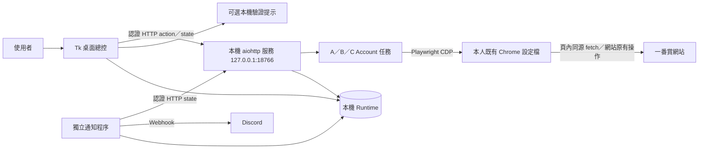

# Kuji Desk 架構說明

更新：2026-11-25。本檔描述目前來源；實際套用狀態見 AI_CONTEXT.md，暫時工作見 CODEX_PROGRESS.md。

## 程序與資料流

GUI、服務、通知程序可來自不同版本的 EXE，彼此有各自生命週期。關 GUI 不等於關服務或退出網站隊伍；替換通知程序不需重啟排隊服務。

## 模組責任

| 檔案 | 責任與主要入口 |
| --- | --- |
| desktop.py | EXE 入口；一般模式開 GUI，--server 開服務，--notifier 開通知程序 |
| native_ui.py | Tk 卡片、設定、歷史、非模態驗證提示；Client 呼叫本機 API |
| manager.py | Manager 共用連線／鎖；Account 開頁、監看、進箱、隊伍同步、離箱與接續 |
| details.py | READ_DETAIL 讀可見 DOM；解析個人順位、籤數與各賞，區分個人與總等待數 |
| cloudflare_pause.py | 辨識明確真人驗證文字或 challenge 回應，交由本人處理 |
| notifications.py | 獨立輪詢狀態、DC 傳送、事件去重、15 秒一般異常穩定判定 |
| service_runtime.py | 認證式 Runtime 尋址、先保留 18766 埠、單檔子程序環境 |
| login_store.py | 歷史本機登入備份；現版主要沿用 Chrome 本身的登入 |
| build_exe.py | PyInstaller 單檔分享包；不封裝 Runtime 或私人設定 |

web/ 與 browser-box-scan/ 是保留的舊網頁介面／獨立擴充套件；不是現版桌面監看引擎。研究工具和 .bak 檔不作啟動入口。

## 瀏覽器與帳號隔離

1. 本人開啟正常 Chrome，在各設定檔登入，啟用遠端偵錯並允許助手連線。
2. GUI 從 Local State 的 info_cache 顯示設定檔名稱／目錄，必須本人明確選擇。last_used 不代表剛選的視窗，不能依此自動綁定。
3. 共用 connect_over_cdp('chrome', timeout=60000) 連線，以 browser_lock 串行建立；失效後清理引用，舊回呼不得清掉新連線。
4. 一個 Playwright context 可能包含多個真實 profile，必須以每頁 Target.getTargetInfo.browserContextId 分隔 A／B／C。
5. 用同 profile 的短暫 chrome://version 頁讀 profile_path 末段辨識目錄，完成即關閉辨識頁；不關原網站頁。
6. 外部 Chrome 的 context 不屬助手所有，服務停止只斷線，不 close 使用者 context。

## 查箱、入場與排隊

- 正常列表：page.evaluate(FETCH_BOX_HTML) 在該帳號頁內同源 fetch；credentials=include、cache=no-store、15 秒 AbortController。驗證 HTTP、回應網址、商品與驗證訊號後解析 HTML，查詢不 reload 整頁。
- 新箱：最大流水號為基準，籤數精確相等才符合；每輪依 minSeconds/maxSeconds 隨機等待。找到後走網站既有進箱／排隊入口一次，結果不明先讀狀態。
- 入場限制：明確「一時的」且 entryRefresh 開啟才建原頁加四助手頁。各頁獨立抖動；明確 429/503 冷卻共用。首個同商品成功頁接續，其餘只清理本次追蹤的助手頁。
- 建助手頁必須從正確 profile 的原頁 window.open，再核對 browserContextId。共享 context.new_page 可能建錯 profile；直接 Target.createTarget 指定一般 profile 不支援。
- 順位（v1.5.37待套用）：原分頁 POST SelectBoxDetail.aspx/GetLotteryBoxWaitCount，使用同頁身分與Cookie，解析d.your_waiting_no；約10秒輪詢。d可能是JSON字串或物件，拒絕空值、負數與非整數。
- 庫存（v1.5.37待套用）：原分頁 GET 當前箱頁解析HTML，每180秒與手動按鈕更新；不是官方JSON庫存API，不整頁刷新。手動更新同時查順位。
- 最新順位30秒內優先於靜態DOM；庫存source=api時不被DOM蓋回，切箱清除舊資料與優先時間。失敗保留上次值，每類錯誤事件最多每分鐘一筆；缺資料不推定0。驗證時停自動操作。
- 讀到有效庫存0時恢復既有售完接續；診斷實站查詢時必須關閉autoResumeSoldOut，避免讀取測試觸發離箱。
- Cloudflare：暫停自動操作、保留視窗，讓本人完成驗證。完成後由本人再啟動；不處理驗證碼或自動付款。

主要階段：idle → watching → opening → submitting → waiting → ready。uncertain 表示狀態待確認；recovering 表示入場或離箱等待；leaving 為正式離箱。不能用 phase 名稱代替核對實際頁面。

## 輪到時離箱修正（服務 v1.5.35，尚待套用）

READ_DETAIL 原本僅看 customAlert，會漏掉「可見 lbMoveToCartFlow＋N分以内にくじを引いてください」的輪到頁。新來源已補上。

- 有正式退出入口：沿用單次退出與確認，核對返回同商品列表後監看。
- 輪到且沒有退出入口：leave_and_requeue 改啟動 wait_turn_then_requeue 背景等待，phase=recovering，可停止。
- 網站釋放名額並返回同商品列表，或重新提供退出入口，才接續監看；不再 goto 列表後假設已退出。
- 只確認原本已辨識的 paymentTimeout 提示，未知彈窗不自動同意；商品／箱號改變或驗證會停止。

這不保證立即放棄名額，也不保證網站會自動返回；完整倒數後接續尚未實站確認。

## 通知與去重

| 事件 | 時機 | 去重方式 |
| --- | --- | --- |
| 輪到你／順位門檻／售完 | 符合條件時 | 沿用既有工作事件鍵與設定的重複間隔 |
| 一般 uncertain | 同帳號、同箱、同 note 持續 15 秒 | 帳號＋商品＋箱號組鍵，跨 startedAt／重排沿用；恢復即取消待發 |
| Cloudflare DC | 明確驗證 note 出現 | 帳號＋該次事件 at，同次只發一次 |
| Cloudflare 彈窗 | GUI 輪詢發現且開關開啟 | 與 DC 共用事件鍵，另存本機提示紀錄；不受 DC 總開關影響 |
| 通過入場限制 | 仍是可選事件 | 依 entryPassedAt；作者本機已停用，非刪除程式功能 |

repeat_enabled=false 時同箱一般異常不因重排重新提醒；true 時仍按設定間隔重複。一般異常穩定判定使用 monotonic；不延遲 Cloudflare、輪到或售完。DC 送達不明不自動重送；僅明確限速依回應重試。

## 本機持久資料與交付界線

Runtime 的 job-A/B/C.json 保存任務與設定檔目錄；events-A/B/C.jsonl 保存事件。discord.json、discord-events.json、cloudflare-popups.json 分別保存通知設定、傳送去重與彈窗去重。panel-session.json 是本機 API 憑證。

服務僅監聽 loopback；先 bind 埠再發布憑證，避免重複啟動覆寫 token。GUI 以已認證探測尋找既有 Runtime。獨立執行通常使用 LocalAppData/KujiDesk，本機來源可明確指定既有 Runtime。

所有 Runtime、登入、Cookie、Webhook、token 和個人執行紀錄不得放入 EXE、分享 ZIP 或 GitHub。來源、EXE、正在執行的程序與 GitHub 標籤必須分開核對。
